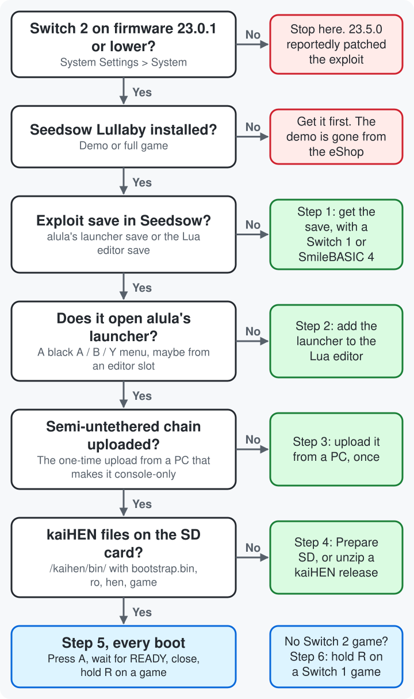

# seedsow2kaihen

A guide from Seedsow Lullaby to kaiHEN and hbmenu on a Switch 2, using the projects the community
has already built. This repo only links to them. It has no code, saves, kaiHEN builds or game files.

**Last checked: 2026-11-20.** These projects change almost daily. If a project's own README says
something different from this page, trust the project. Exact versions are at the
[bottom](#versions-this-was-checked-against).

> [!WARNING]
> kaiHEN gives homebrew full access to the system, NAND included, and the exploit behind it can brick
> a console. Use all of it at your own risk, on a console and games you own. See [Legal](#legal).

## The short version

| # | Step | How often |
|---|---|---|
| 1 | [Get an exploit save into Seedsow](#1-get-an-exploit-save-into-seedsow) | Once. The hardest part. |
| 2 | [Lua editor only: add the launcher](#2-lua-editor-only-add-the-launcher) | Once, only with the Lua editor save |
| 3 | [Upload the semi-untethered chain](#3-upload-the-semi-untethered-chain) | Once, from a PC |
| 4 | [Put kaiHEN on the SD card](#4-put-kaihen-on-the-sd-card) | Once |
| 5 | [Start kaiHEN after every boot](#5-start-kaihen-after-every-boot) | Every boot. No PC. |
| 6 | [Optional: hold R on a Switch 1 game](#6-optional-hold-r-on-a-switch-1-game) | Once, if you have no Switch 2 game |

kaiHEN lives in RAM, which is why step 5 is needed after every reboot (semi-untethered).

## Where do I start?

Follow the questions from the top. You don't have to start at step 1.



## Words used here

| Term | What it is |
|---|---|
| **Exploit save** | A modified Seedsow save that runs Lua when the game starts. The exploit lives here, in the save data, **not on the SD card**, so you can't start from an SD card alone. |
| **alula's launcher save** | `seedsow_save.zip` from [switch-artemis-launcher](https://github.com/alula/switch-artemis-launcher), also called the Artemis launcher or seedsowhax. Seedsow opens into a black menu: **A** runs the exploit, **Y** starts an HTTP server on port 8080. |
| **Lua editor save** | `Seedsow-Lua-Editor-Save.zip` from [seedsow-lua-editor](https://github.com/DialingSpoon527/seedsow-lua-editor). An editor in the game's LOAD menu. Needs alula's launcher added to a slot (step 2). |
| **Semi-untethered chain** | The Lua that runs the whole exploit on the console when you press A. Uploaded into the save once. |
| **kaiHEN** | What the exploit starts. Its files sit on the SD card; it runs in RAM. |
| **hbmenu** | The homebrew menu. Once kaiHEN runs, hold R while starting a game to get it. |

## 1. Get an exploit save into Seedsow

If you can choose, get **alula's launcher save**. Everything after this builds on it, and starting
kaiHEN is then just pressing A. Only pick the Lua editor if you want the editor itself.

| Route | You need | Status | Guide |
|---|---|---|---|
| **Hacked Switch 1** + Nintendo save transfer | Switch 1 with Atmosphère and JKSV, both consoles online | The usual way. **May not work since 23.5.0** (see below). | [alula's Setup](https://github.com/alula/switch-artemis-launcher#setup), [seedsow-lua-editor](https://github.com/DialingSpoon527/seedsow-lua-editor) |
| **SmileBASIC 4** + [ns2-savekit](https://github.com/dougchansan/ns2-savekit) | SB4, a PC on the same network ([Network](#network)), Switch 2 on 23.0.1 or lower | Author reports both saves working on hardware, "no Switch 1, no JKSV, no Nintendo save transfer". Read its open issues first. | [ns2-savekit](https://github.com/dougchansan/ns2-savekit); wrapper: [seedsow-save-pack](https://github.com/Politodev/seedsow-save-pack) (experimental) |
| **Civilization VII 1.0.0** + [seedsow-port-kit](https://github.com/ninjadudexp/seedsow-port-kit) | Civ VII 1.0.0, a PC, [CivSwitchFS](https://github.com/ItsNerisma/CivSwitchFS) | Described in its README. No hardware report found yet. | [seedsow-port-kit](https://github.com/ninjadudexp/seedsow-port-kit) |
| **Civilization VII** + kaiHEN + [JKSV-NS2](https://github.com/Aster145/JKSV-NS2) | Civ VII already giving you kaiHEN | Nobody has reported restoring a Seedsow save this way yet. You already have kaiHEN, so mostly step 6 matters to you. | [JKSV-NS2](https://github.com/Aster145/JKSV-NS2) |

> [!IMPORTANT]
> **The Switch 1 transfer may not work any more.** The last success reports we found are from early
> November, with both consoles on 23.0.1. Firmware 23.5.0 came out on 2026-11-10, and Nintendo's
> support pages say both consoles need the latest system update for a transfer. Nobody has reported
> yet whether a Switch 2 still on 23.0.1 can receive one. If you try, please report back either way.

**What the transfer needs:**
- Both consoles on the real internet. Nobody has reported it working offline or with Nintendo blocked by DNS, so turn fake DNS off for this step.
- The consoles near each other, users on both linked to the same Nintendo Account. No Switch Online needed.
- The same edition on both sides: demo to demo, full game to full game.
- The restore done on the Switch 1's sysNAND, not emuMMC (emuMMC has separate saves). CFW on sysNAND isn't ban-proof.
- A JKSV backup first. The transfer moves the save and deletes the Switch 1's copy.
- Saying no to the system update the Switch 2 offers once it's online.
- The cloud-save route doesn't avoid the Switch 1, and needs the full game on both plus Switch Online.

## 2. Lua editor only: add the launcher

**Skip this** if your save is alula's launcher, or your editor already has the launcher in a slot.

The editor can't run the chain by itself, so you add alula's launcher to a free slot with the
`artemis-installer` branch of [seedsow-lua-editor](https://github.com/DialingSpoon527/seedsow-lua-editor).
The hard part is getting a small uploader (about 3,700 characters) into the editor. Once it runs, it
fetches the launcher from your PC over the network.

| Way to type the uploader | Needs | Notes |
|---|---|---|
| **By hand** from the typing sheet | A controller, or a wired USB keyboard (much faster) | Rows of 32 characters at most; check the byte count at the end. The only method with earlier hardware reports. |
| **Raspberry Pi** as a Bluetooth controller | A Linux Pi | Driven from the PC companion app. |
| **Pico** + [switch-pico](https://github.com/jyapayne/switch-pico) | RP2040 Pico, USB-to-UART adapter | Takes tens of minutes. |
| **Modded Switch 1** with [Plume USB](https://github.com/MichelSama/plume-usb) | A modded Switch 1 and a cable | Uses [RealRobertBrownieJr's text chunks](https://github.com/RealRobertBrownieJr/seedsow-artemis-plume-installer). |

The installer's README says its new guides, Pi service and Pico sender still need a full hardware test.

**Easy to miss:**
- The PC needs Python 3.10 or newer.
- Two addresses: the uploader holds the **PC's** IP; later steps use the **console's** IP (in its Internet settings).
- Let Python through the PC's firewall. Console and PC on the same network with fake DNS ([Network](#network)), no guest Wi-Fi or VPN.
- Use two free slots between 4 and 120. Slots 1 to 3 are the editor, receiver and backup editor.
- The [troubleshooting page](https://github.com/DialingSpoon527/seedsow-lua-editor/blob/artemis-installer/docs/05-troubleshooting.md) matches the exact text on screen to a fix.

## 3. Upload the semi-untethered chain

After this, you never need the PC to start kaiHEN. Open Seedsow (if your launcher is in an editor slot,
load that slot) and press **Y** to start the launcher's HTTP server. Then upload from a PC on the same
network (see [Network](#network) for the fake DNS), using the console's IP.

| Option | Good for | How |
|---|---|---|
| **[seedsow-fs-kaihen](https://github.com/Malev0/seedsow-fs-kaihen) GUI** | Easiest, buttons in a browser | Node.js 20+. Start it with the `start-gui` script for your system, then press **Upload Console-Only Save**. It also does step 4 (**Prepare SD**). |
| **[seedsow-semi-untethered](https://gitlab.com/rushinz/seedsow-semi-untethered)** by rushinz | The original; gets fixes first; no kit needed | `node tools/upload-semi-untethered.cjs --host <console IP>` |

- The kit's README says to copy the launcher save to a **second profile** first and upload there, so
  your main profile's save stays clean.
- The chain tries up to 10 times on its own and cleans up between attempts. If it can't safely retry,
  it tells you to restart.
- It never changes the launcher's original files. To recover, hold **Minus** before pressing **Y**: the
  original HTTP server starts.
- The HTTP server runs any code it's sent, with no password. Only use it on a network you trust.

<details>
<summary>Other tools</summary>

- The kit can also run the exploit from the PC each time, without uploading the chain. Then you need
  the PC on every boot.
- [mac2jb](https://github.com/cpypwn/mac2jb) is an all-in-one Mac app covering ns2jb, CivSwitch,
  Seedsow and kaiHEN. It needs an Apple-silicon Mac with SIP turned off for an unsigned kext.

</details>

## 4. Put kaiHEN on the SD card

kaiHEN comes from the [ouncebrew/kaihen releases](https://github.com/ouncebrew/kaihen/releases). Any
microSD card works, Express not needed. Use FAT32, or exFAT if your console has the exFAT update.

| With | Do this |
|---|---|
| The kit | Put the SD card in the PC and press **Prepare SD**. It downloads the release if needed. |
| rushinz's chain | Unzip the release to the SD card's root or a `kaihen` folder. The chain moves the files into place on its first run. |

The chain won't start without these four files:

```text
/kaihen/bin/bootstrap.bin
/kaihen/bin/ro/main
/kaihen/bin/hen/main
/kaihen/bin/game/main
```

The kit's PC mode doesn't add `bootstrap.bin` and `ro/main`. If you only ever used PC mode, the chain
says "required SD files missing" until you do this step.

## 5. Start kaiHEN after every boot

1. Open Seedsow and press **A** in the launcher.
2. Wait for this line. Usually about a minute; each retry adds about 35 s.
   ```text
   KH: === READY! Close Seedsow Lullaby and hold R while launching a game ===
   ```
3. Close Seedsow. Hold **R** and start a Switch 2 game. The first time it just starts normally: close
   it and do it again to get **hbmenu**. No Switch 2 game? See step 6.

No PC and no network needed.

> [!NOTE]
> **Launcher in a Lua editor slot?** Don't press A on the first launch after a boot, or the game
> freezes. Load the slot, close the game, open it again, load the slot again, then press A
> (from rushinz's README).

## 6. Optional: hold R on a Switch 1 game

Normal kaiHEN only works with Switch 2 games; holding R on Seedsow or another Switch 1 game just
starts it. [kaihen-switch1-titles](https://github.com/ignotusbucius/kaihen-switch1-titles) changes
that. Build its HEN as described there and put `hen/main` at `/kaihen/bin/hen/main`.

- **First R launch** of a Switch 1 game: it starts normally while kaiHEN builds a package from it on the SD card (about 15 s).
- **After that:** holding R on that game or any other Switch 1 game opens hbmenu, even after a reboot.
- **Keep a copy** of `hen/main`. A new kaiHEN release, or the kit's Update kaiHEN or Prepare SD, overwrites it.
- **Limits:** homebrew gets that Switch 1 game's permissions, and probably Switch 1 memory and speed. Not measured yet. For emulators, use a Switch 2 game if you have one.
- **Status:** offered to kaiHEN as pull requests #18 and #19, not merged yet.

## Demo or full game

The projects disagree, so check before you count on the full game.

| Project | Says |
|---|---|
| alula's launcher | Demo only; full game "not yet". Also says the demo has been pulled from the eShop. |
| rushinz's chain, seedsow-fs-kaihen | Demo or full game. The kit's author says it's tested working on the full game. |
| Lua editor | Reported working on the full game, but its installer warns not to assume alula's launcher is. |

None of them explains how someone with only the full game gets the launcher save. Read alula's README
and the kit's issues first.

## Network

Steps 1 (without a Switch 1), 2 and 3 need the Switch 2 and your PC on the **same Wi-Fi network**,
because the PC talks to the console directly. The catch: a Switch 2 runs a connection test against
Nintendo's servers when it joins a network. So you need a network where the console thinks it reached
Nintendo, but can't actually reach Nintendo (no updates, no telemetry). Experienced users keep this
setup on the whole time: **a fake DNS** that answers Nintendo's connection test locally and blocks
everything else.

| Step | Network needed | Why |
|---|---|---|
| 1, from a Switch 1 | **Real internet** on both consoles | Nintendo's save transfer goes through Nintendo's servers. Turn fake DNS off for this step only. |
| 1, without a Switch 1 | Fake DNS, same network as the PC | The console connects to the ns2jb host on the PC (TCP port 39380). |
| 2 | Fake DNS, same network as the PC | The uploader pulls the launcher from the PC. |
| 3 | Fake DNS, same network as the PC | The PC talks to the launcher's HTTP server (port 8080) at the console's IP. |
| 5 | None | The chain runs entirely on the console. |
| Using hbmenu | Fake DNS, same network as the PC | NetLoader, FTP and similar homebrew go over the network. |

**Setting it up:**
- **Fake DNS:** either your own DNS server (for example dnsmasq on the PC) that answers Nintendo's
  connection-test host with the reply the console expects and blocks the rest, or
  [90DNS](https://gitlab.com/a/90dns). 90DNS's README says to disable IPv6 on Switch 2, and that a
  2160-8007 error on the connection test means it's working.
- In the console's Internet settings, set the DNS manually to your fake DNS, and set the IPv6 DNS to `::`.
- If your router can, block the console's internet access too. DNS blocking alone isn't a guarantee.
- **Never press Update** if the console offers a system update. Choose Start Software.
- If an update may have downloaded anyway, power off and clear it through maintenance mode before
  you continue.
- The console's IP address is shown in its Internet settings. That's what you give the PC tools.

## Troubleshooting and FAQ

See [FAQ.md](FAQ.md).

## Versions this was checked against

| Project | Release | Latest commit |
|---|---|---|
| [alula/switch-artemis-launcher](https://github.com/alula/switch-artemis-launcher) | v2 (2026-11-05) | `ae02495` (2026-11-08) |
| [DialingSpoon527/seedsow-lua-editor](https://github.com/DialingSpoon527/seedsow-lua-editor) | v0.1.3 (2026-10-28) | `artemis-installer` `72e9cdc` (2026-11-20), `main` `88f443f` (2026-11-01) |
| [rushinz/seedsow-semi-untethered](https://gitlab.com/rushinz/seedsow-semi-untethered) | v1.0.0 (2026-11-20) | `6201c358` (2026-11-20) |
| [Malev0/seedsow-fs-kaihen](https://github.com/Malev0/seedsow-fs-kaihen) | none | `ff14e26` (2026-11-20) |
| [ouncebrew/kaihen](https://github.com/ouncebrew/kaihen) | 20261117.1 (2026-11-17) | `9aa3716` (2026-11-17) |
| [ignotusbucius/kaihen-switch1-titles](https://github.com/ignotusbucius/kaihen-switch1-titles) | none | `76bcebd` (2026-11-20); kaiHEN #18 and #19 open |

## Legal

- Not affiliated with, endorsed by or sponsored by Nintendo. Nintendo Switch and Nintendo Switch 2 are
  trademarks of Nintendo. Game titles are trademarks of their owners, named only to say what the
  projects run on.
- This repo contains no Nintendo code, firmware, keys or game files, and no saves, exploits or
  programs from the linked projects. It only links to them.
- Nothing here helps you run a game you don't own. It's for running homebrew on your own console.
- Don't post saves, keys, NAND dumps, game files or donor packages in issues.
- A console running homebrew that goes online can be banned from Nintendo's online services.
- No warranty. Each linked project has its own licence and terms; read them.

## Licence

The text and chart in this repo are [CC BY 4.0](LICENSE). The linked projects have their own licences.

## Credits

All the real work is in the linked projects: alula (switch-artemis-launcher), DialingSpoon527
(seedsow-lua-editor), rushinz (seedsow-semi-untethered), Malev0 and the seedsow-fs-kaihen
contributors, dougchansan (ns2-savekit), Politodev (seedsow-save-pack), ninjadudexp
(seedsow-port-kit), Aster145 (JKSV-NS2), RealRobertBrownieJr (Plume installer), MichelSama (Plume
USB), jyapayne (switch-pico), cpypwn (mac2jb), kurumuz and the kaiHEN contributors (kaiHEN, ns2jb),
pepsipu (ns2jb), Gezine (CivSwitch), ItsNerisma, Slapah and the CivSwitchFS authors, ouncebrew (devkit,
libounce, OunceShell) and switchbrew.
